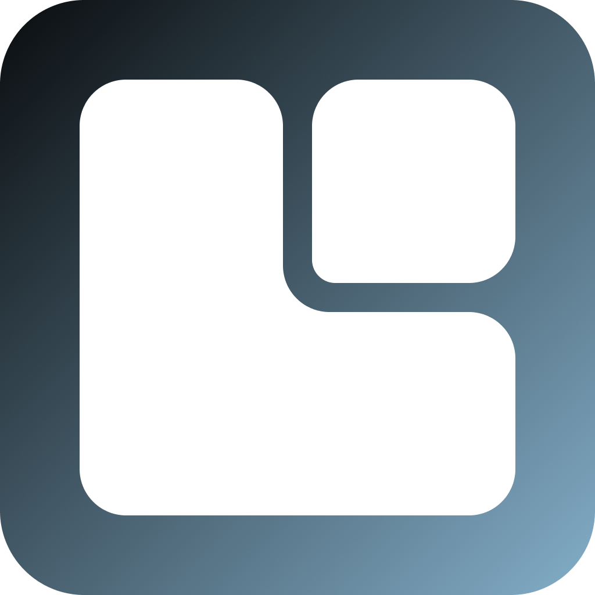

<p align="center"></p>

<h1 align="center">LumiDeck</h1>

<p align="center">Your Android device as a desktop computer: an open alternative to Samsung DeX.</p>

---

LumiDeck draws a desktop on a big screen while your apps keep running on the device. The taskbar is a floating panel in the style of KDE Plasma, with the LumiDeck logo on the left.

There are two ways to use it, and both show the same desktop:

| | How | Needs |
|---|---|---|
| **On a PC** | Run the LumiDeck client and the desktop opens in a window | USB cable (Wi-Fi later) |
| **On a monitor** | Plug the device straight into a monitor over USB-C | A device with USB-C video out (DP Alt Mode) |

> **Status:** early prototype (Phase 0). The Windows client is a thin wrapper around [scrcpy](https://github.com/Genymobile/scrcpy).

## How it works

```
 Android device
 ├─ LumiDeck desktop (android/)   ← runs on every external display
 │     │
 │     ├── USB-C → monitor        (Android drives the display)
 │     └── virtual display → PC   (desktop/ streams it into a window)
```

Android starts a launcher's `SECONDARY_HOME` activity on each extra display, but only if that launcher is the default home app. LumiDeck therefore becomes the default home, and on the device's own screen it forwards Home to whichever launcher you pick.

## Quick start (Windows)

You need Android Studio (or the Android SDK) and scrcpy:

```powershell
winget install --id Google.AndroidStudio -e
winget install --id Genymobile.scrcpy -e
```

1. On the device, turn on **Developer options → USB debugging** and plug it into your PC.
2. Run the one-time setup. It builds and installs the app, turns on desktop mode and reboots the device:
   ```powershell
   powershell -ExecutionPolicy Bypass -File scripts\setup-device.ps1 -Reboot
   ```
3. On the device, open LumiDeck and pick your normal launcher under **Launcher on this screen**.
4. Open the desktop on your PC:
   ```powershell
   powershell -ExecutionPolicy Bypass -File desktop\lumideck.ps1
   ```
   Options: `-Fullscreen`, `-Resolution 2560x1440 -Dpi 200`, `-ScreenOff`, and `-Serial <id>` when several devices are connected.

To use a monitor instead, do steps 1–3, then plug the device into the monitor with a USB-C to HDMI or DisplayPort adapter.

### Using the desktop

- **Logo button** or **Meta (Windows key)**: open or close the app menu. Type to search, press **Enter** to open the first result, **Esc** to close.
- **Right-click or long-press** an app in the menu to pin it to the taskbar.
- Open apps appear in the taskbar after the pinned ones, with a line under them. Click one to bring it to the front, or to minimise it if it's already there. Right-click or long-press it to maximise, minimise, pin or close it.
- The taskbar stays above app windows, even maximised ones. This needs Android's "Display over other apps" permission, which the setup script and the PC client grant; without it the taskbar sits behind apps.
- Open apps in the taskbar need the **window helper**, a small program the PC client starts over ADB (Android doesn't let apps manage other apps' windows). It keeps running after you unplug, until the device reboots. To use a monitor after a reboot, plug into the PC once and run `scripts\setup-device.ps1 -SkipInstall`. Without the helper, the taskbar shows only pinned apps.
- In the PC window, scrcpy's own shortcuts use **Right Ctrl** (for example, Right Ctrl+F toggles fullscreen).

## Repo layout

| Folder | What |
|---|---|
| `android/` | The desktop and launcher app (Kotlin, Jetpack Compose) |
| `desktop/` | The PC client. For now a PowerShell wrapper around scrcpy; later a native Rust app for Windows, Linux and macOS |
| `scripts/` | Device setup |
| `img/` | Logos |

## Roadmap

- [x] **Phase 0:** desktop app with floating taskbar, app menu, pinned apps, battery and clock; Windows client using scrcpy
- [ ] **Phase 1:** ~~taskbar as an always-on-top overlay~~ (done), app tooltips, settings
- [ ] **Phase 2:** polished Windows client: tray icon, auto-connect, clipboard and file drag-and-drop
- [ ] **Phase 3:** window management: ~~running apps in the taskbar with focus, minimise, maximise and close~~ (done, via ADB), Shizuku so it works on a monitor without a PC, Alt+Tab, snapping
- [ ] **Phase 4:** native Rust client, Wi-Fi mode
- [ ] **Phase 5:** Linux and macOS clients; themes, notification centre, widgets

## Known limits

- Android gives every desktop-mode screen its own navigation-bar strip along the bottom. It shows the wallpaper while the desktop is focused and turns black while an app is focused. The taskbar sits just above it. Hiding it needs system-level access, which is planned for Phase 3.
- Android's Settings app hides the taskbar while it's open, because it hides everything apps draw over other apps.
- Some apps don't resize well in windows.
- Device makers can change how desktop mode behaves. On Samsung phones, DeX takes over external monitors.
- **Anbernic RG556:** video out tops out at 1080p, and the device can't charge while it's driving a monitor. That's why the battery level always shows in the taskbar. Its firmware can also forget LumiDeck as the home app after a reboot. The PC client re-applies it each time, but on a monitor you may need to run `scripts\setup-device.ps1 -SkipInstall` again.

## Credits

The Windows client v0 uses [scrcpy](https://github.com/Genymobile/scrcpy) (Apache-2.0) by Genymobile.
